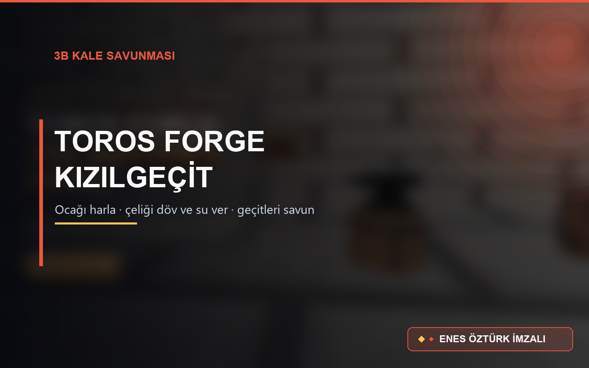
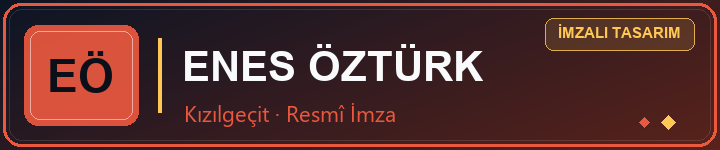
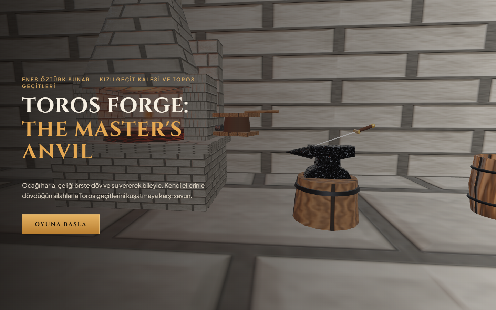
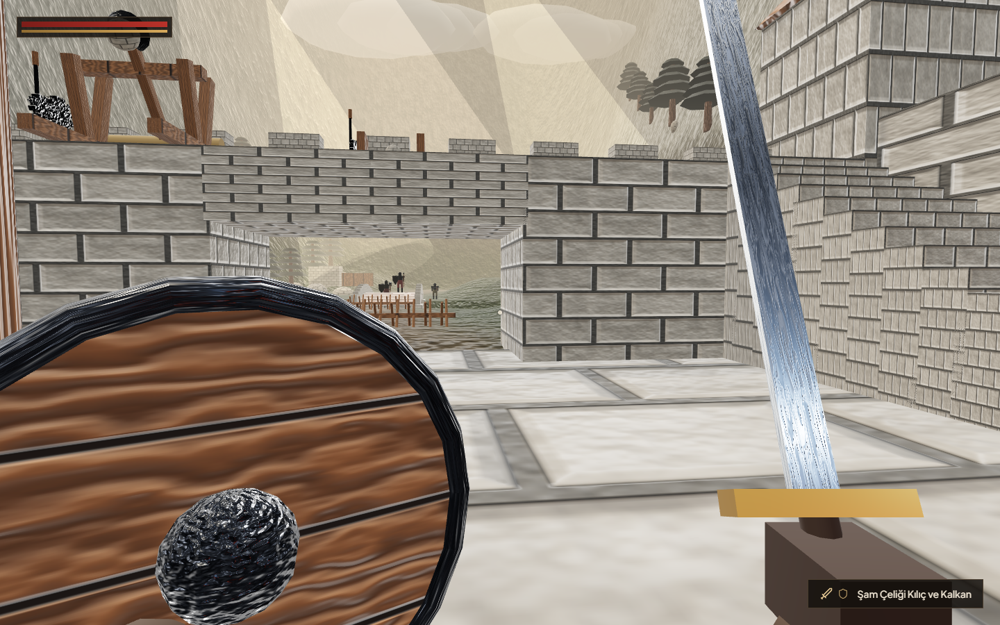

<div align="center">



# Toros Forge: Kızılgeçit

**Enes Öztürk imzalı; ocağı harlayıp Şam çeliği dövdüğünüz, kendi ellerinizle yaptığınız silahlarla Toros geçitlerini kuşatmaya karşı savunduğunuz 3B demircilik aksiyonu.**

[](https://github.com/EnesBinMalik/toros-forge-masters-anvil-kizilgecit)
[](https://react.dev/)
[](https://www.typescriptlang.org/)
[](https://threejs.org/)
[](https://vite.dev/)

[](https://github.com/EnesBinMalik)
[](https://github.com/EnesBinMalik/toros-forge-masters-anvil-kizilgecit)
[](https://github.com/EnesBinMalik/toros-forge-masters-anvil-kizilgecit)
[](https://github.com/EnesBinMalik/toros-forge-masters-anvil-kizilgecit)



</div>

---

## Hakkında

**Toros Forge: Kızılgeçit**, demirciliğin doğrudan savunmaya dönüştüğü ayrı bir oyun deneyimidir. Ocağı harlar, çeliği tavına getirip örste döver, su fıçısına daldırarak bileylersiniz. Kuşatma öncüleri ve arbaletçiler geçide ilerlerken kazık barikatlarını onarır, sur okçularını desteklersiniz.

Dövdüğünüz **Şam Çeliği Kılıç ve Kalkan**, **Örs Dövme ve Zırh Kırıcı** ya da **Ağır Savaş Baltası** ile düşman hatlarını kırarsınız. Çelik soğuduysa yeniden ocakta ısıtmanız gerekir; dövme döngüsü canlı bir mekanik olarak oyunun merkezindedir. Tüm modeller, dokular ve ses sistemi **Three.js** ile sıfırdan yazılmıştır.

> Bu proje **Enes Öztürk** tarafından tasarlanmış, geliştirilmiş ve imzalanmıştır.

---

## Öne çıkan özellikler

| Özellik | Açıklama |
| --- | --- |
| **Canlı dövme döngüsü** | Isıt → örste döv → suya daldır → bileyle; çelik soğursa yeniden ısıt. |
| **Şam Çeliği silahlar** | Kılıç+kalkan, zırh kırıcı ve ağır balta için ayrı dövme tarifleri. |
| **Kazık barikatı onarımı** | `E` ile kapı önü ve köprübaşı barikatlarını güçlendirme. |
| **Sur okçuları** | Usta işi silah dövdüğünüzde sur savunmacıları desteğe katılır. |
| **Kuşatma dalgaları** | Öncüler ve arbaletçiler geçide doğru ilerler; savunma hattını koruyun. |
| **El yazması harita** | `M` ile cephe haritasını açıp mevzileri inceleme. |
| **Diegetik göstergeler** | Çelik sıcaklığı ve zırh bütünlüğü doğrudan teçhizatta okunur. |
| **İmzalı tasarım** | Baş Mimar Enes Öztürk'ün kişisel imzasını taşıyan özgün yapım. |

---

## Savunma hatları

| # | Cephe | Açıklama |
| --- | --- | --- |
| 01 | Kızılgeçit Kalesi | Ana üs, demirci atölyesi ve sur savunma hattı |
| 02 | Geçit Vadisi | Erzak, demir cevheri ve mühimmat menzili |
| 03 | Toros Geçidi İleri Gözetleme Karakolu | Güney boğazındaki ilk savunma ve gözetleme noktası |

Her bölge kendi fizik kuralları, ışıklandırması, dokusu ve akustik karakteriyle ayrı bir deneyim sunar.

---

## Kontroller

| Tuş | Aksiyon |
| --- | --- |
| `W` `A` `S` `D` | Hareket |
| `Sol tık` / `E` | Örste çelik dövme |
| `E` | Suya daldırıp su verme / barikat onarımı |
| `M` | Savunma haritasını aç / kapat |
| `F` | Etkileşim ve savunma eylemleri |
| `H` | Arayüzü gizle |

> Oyun sırasında arayüz tamamen kaldırılabilir: ekranda yalnızca dünya içi telemetri kalır.

---

## Galeri






---

## Kurulum

**Gereksinimler:** Node.js 20+ ve modern bir WebGL tarayıcı.

```bash
git clone https://github.com/EnesBinMalik/toros-forge-masters-anvil-kizilgecit.git
cd toros-forge-masters-anvil-kizilgecit
npm install
npm run dev
```

Uygulama varsayılan olarak `http://localhost:3000` adresinde açılır.

> Oyun tamamen istemci tarafında çalışır; `.env.example` yalnızca AI Studio dağıtım şablonu içindir.

Diğer komutlar:

```bash
npm run build     # Üretim derlemesi (dist/)
npm run preview   # Derlemeyi yerelde önizle
npm run lint      # TypeScript tip kontrolü
```

---

## Teknik mimari

```text
src/engine/TorosEngine.ts        Oyun döngüsü ve kuşatma sistemi
src/engine/worldBuilder.ts       Cepheler ve savunma yapıları
src/engine/geometryBuilders.ts   Örs, ocak, barikat ve surlar
src/engine/textures.ts           Demirci ve kale dokuları
src/engine/audio.ts              Dövme ve kuşatma sesleri
src/components/GameHud.tsx       Dövme durumu ve göstergeler
src/components/ParchmentMapModal.tsx  El yazması harita
src/components/TitleScreen.tsx   İmzalı açılış ekranı
```

---

## İmza

<div align="center">

[](https://github.com/EnesBinMalik)
[](https://github.com/EnesBinMalik)

**Bu kod, tasarım ve deneyim Enes Öztürk'ün kişisel imzasını taşır.**

© 2026 Enes Öztürk — Tüm hakları saklıdır.

</div>
